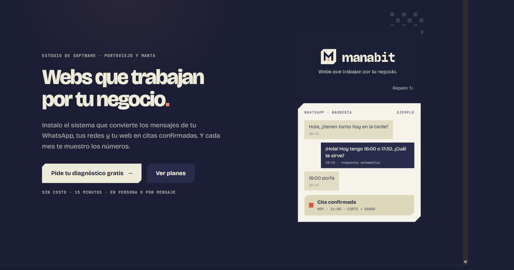
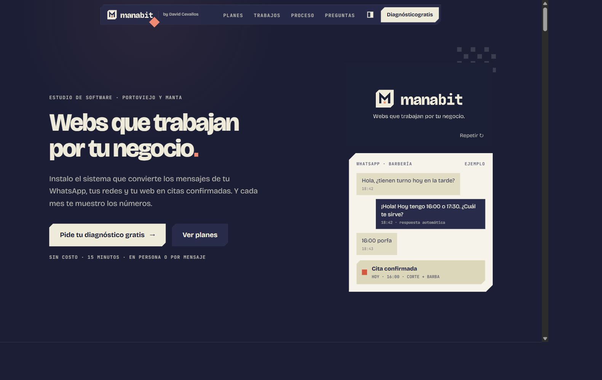
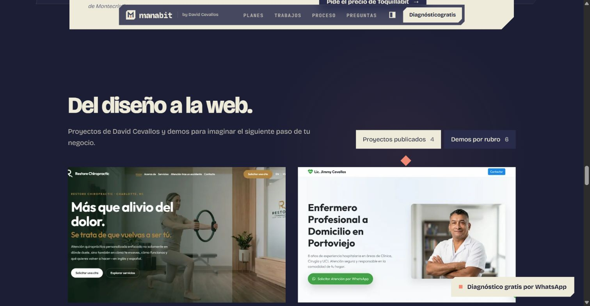
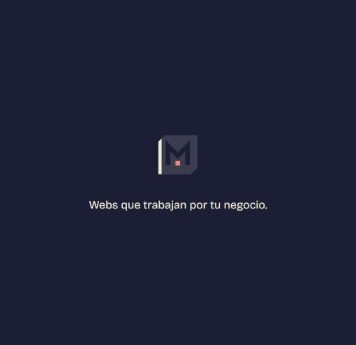

<div align="center">



# manabit

**Estudio de software · Portoviejo, Manabí**

Webs que trabajan por tu negocio.

by **[David Cevallos](https://davidcevallos.vercel.app)**

[Ver la web](https://manabit-three.vercel.app/) · [Pedir diagnóstico](https://wa.me/593979107716?text=Hola%2C%20quiero%20el%20DIAGN%C3%93STICO%20gratis%20para%20mi%20negocio.)

</div>

## Qué es

Landing de Manabit, estudio de software de David Cevallos en Portoviejo. Presenta sistemas web para negocios de servicio y permite pedir un diagnóstico gratis por WhatsApp: página, reservas, confirmaciones y seguimiento de resultados.

## Qué incluye

- **Carga inicial:** loader SVG original del kit. La M se revela y el bit coral late. Espera la carga del documento y las fuentes, con una entrada breve de 850 ms y un límite de 3 segundos. Un respaldo independiente retira la pantalla a los 4,5 segundos si falla la hidratación. Con movimiento reducido se omite la espera. Sin JavaScript no se muestra una pantalla de carga que bloquee el contenido.
- **Hero:** video original de inicio, chat de ejemplo y diagnóstico por WhatsApp.
- **Calculadora:** estimación con los valores introducidos por el visitante; no representa resultados de clientes.
- **Sistema y planes:** Chiflebit, Tongabit y Toquillabit; alcance y precio se acuerdan tras el diagnóstico.
- **Trabajos:** cuatro proyectos publicados y seis demos de diseño, con capturas reales reutilizadas del portafolio de David. Los proyectos abren sus webs; las demos abren una consulta específica por WhatsApp.
- **El estudio:** presentación del fundador, avatar, portafolio y video ilustrado con reproducción manual.
- **Proceso y FAQ:** del diagnóstico a la operación mensual.
- **Cierre:** video original, contacto, firma y wordmark grande.
- **Globales:** menú móvil, temas noche/vainilla, Lenis, animaciones de entrada y controles accesibles.

## Vistazo







## Stack

Next.js 16 · React 19 · TypeScript estricto · Tailwind CSS v4 · Motion · Lenis. Fuentes locales Bricolage Grotesque y JetBrains Mono. Exportación estática, sin un backend de formularios ni servicios nuevos.

## Desarrollo

Requiere Node.js 20.9 o superior.

```bash
npm ci
npm run dev
npm run typecheck
npm run build
```

`npm run build` genera `out/`. Para revisar exactamente esa salida:

```bash
python -m http.server 4173 --directory out
```

Abre http://localhost:4173. `next start` no sirve una exportación estática.

## Contacto y contenidos

`src/lib/site.ts` concentra los datos públicos:

```ts
whatsappNumber: "593979107716", // formato internacional sin + ni espacios
email: "jimdav1506ceva@gmail.com",
url: "https://manabit-three.vercel.app",
portfolio: "https://davidcevallos.vercel.app",
```

Los botones de diagnóstico, planes y demos usan `waLink()` y preparan el mensaje. No envían nada automáticamente. LinkedIn enlaza al perfil público de David. Instagram y TikTok no aparecen hasta que se configuren sus URLs.

- `src/content/work.ts`: proyectos, demos, enlaces y descripciones.
- `src/content/plans.ts`: alcance de los planes.
- `src/content/process.ts` y `faq.ts`: proceso y preguntas frecuentes.
- `src/components/brand/PageBoot.tsx`: duración y salida del loader.
- `src/components/brand/BrandVideo.tsx`: videos del kit, tema y controles de pausa/repetición.

## Recursos

| Carpeta | Contenido |
| --- | --- |
| `public/media/brand/` | Videos de inicio/cierre del kit Manabit, medianoche/vainilla |
| `public/media/projects/` | Capturas optimizadas de proyectos y demos |
| `public/media/studio/` | Avatar, video ilustrado y poster del portafolio personal |
| `public/opengraph-image.png` | Portada para compartir, 1200 × 630 |
| `docs/` | Portada, capturas y notas de revisión |

Los videos de marca se reproducen sin sonido al entrar en pantalla y se pausan al salir; permiten pausa y repetición. Con movimiento reducido muestran el logo estático. El video del estudio requiere pulsar reproducir. Las imágenes y los videos se sirven localmente.

Procedencia: kit de marca proporcionado por David y [DavidCevallos15/personal_web](https://github.com/DavidCevallos15/personal_web), en concreto `frontend/src/data/{projects,studio,profile}.ts` y `frontend/public/media/`. Se muestran proyectos personales y profesionales con su contexto original; no se atribuyen todos como clientes de Manabit ni se publican cifras de resultados.

## Marca

| Color | Hex |
| --- | --- |
| Noche | `#1C1E35` |
| Medianoche | `#282B4A` |
| Vainilla | `#EEEBDA` |
| Coral | `#D4573F` |
| Coral claro | `#F08A74` |

Se conservan los contornos originales del logo, los chaflanes y la firma **by David Cevallos** junto al logo y en el footer.

## Publicación

El repositorio está conectado a Vercel. La rama de producción es `main`. El build incluye URL canónica, metadatos Open Graph/Twitter, `robots.txt` y `sitemap.xml`. Al usar un dominio propio, cambia `site.url` y vuelve a desplegar.

Pendiente comercial: confirmar dominio propio, redes de Manabit y precios. Los precios no se inventan ni se publican como una oferta confirmada.

---

Diseñado y desarrollado by **[David Cevallos](https://github.com/DavidCevallos15)**.
