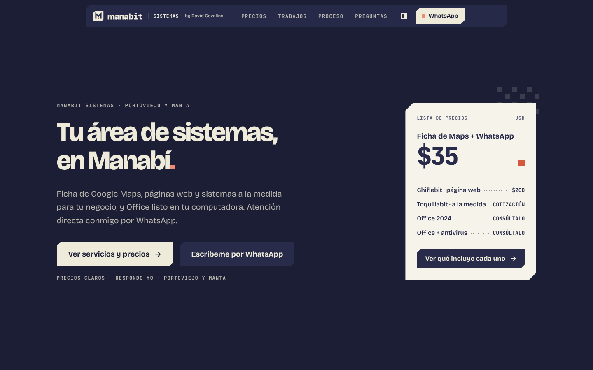
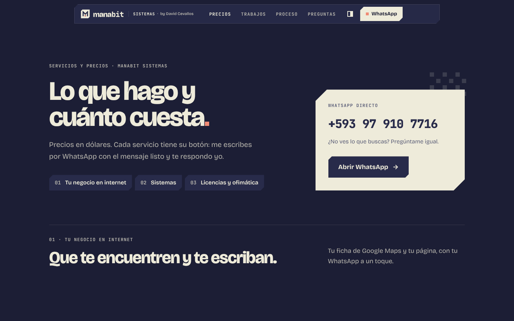
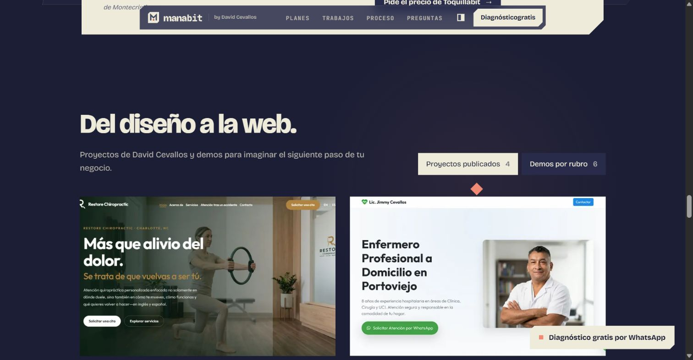
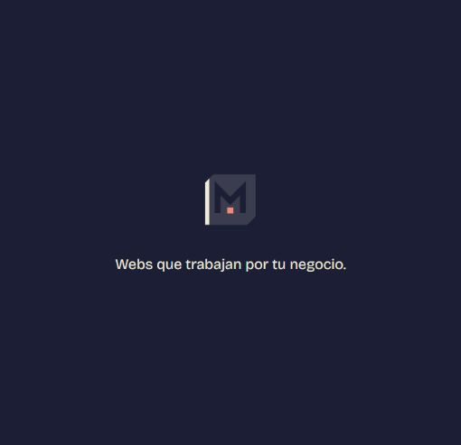

<div align="center">



# manabit sistemas

**Sistemas · Portoviejo, Manabí**

Tu área de sistemas, en Manabí.

by **[David Cevallos](https://davidcevallos.me)**

[Ver la web](https://manabitsistemas.vercel.app/) · [Servicios y precios](https://manabitsistemas.vercel.app/servicios) · [WhatsApp](https://wa.me/593979107716)

</div>

## Qué es

Web de Manabit Sistemas, la marca de David Cevallos en Portoviejo. Vende solo lo que ya existe: ficha de Google Maps con WhatsApp Business, páginas web (Chiflebit), sistemas a la medida (Toquillabit) y Office (sin precio publicado: se consulta por WhatsApp). Tongabit, el sistema de recepción y agenda automática, aparece como "en construcción", sin precio ni fecha.

Tres páginas:

- `/`: la marca, video de presentación, resumen de servicios con precios, trabajos, lo que está en construcción, el estudio, proceso y preguntas.
- `/servicios`: lista de servicios y precios con un botón de WhatsApp por servicio y el número visible. Es la página de destino para anuncios: no muestra pantalla de carga ni animación de entrada en el hero.
- `/clases`: clases en vivo de IA para todos (temario, qué incluye y precio por persona según el tamaño del grupo) y reseñas de quienes ya la tomaron. El link para pedir reseñas al terminar una clase es `/clases#resenas`. Tampoco muestra pantalla de carga.

## Qué incluye

- **Carga inicial:** loader SVG original del kit. La M se revela y el bit coral late. Espera la carga del documento y las fuentes, con una entrada breve de 850 ms y un límite de 3 segundos. Un respaldo independiente retira la pantalla a los 4,5 segundos si falla la hidratación. Con movimiento reducido se omite la espera. Sin JavaScript no se muestra una pantalla de carga que bloquee el contenido.
- **Presentación:** video de un minuto del fundador, con audio y reproducción manual, justo después del hero.
- **Hero:** titular de marca, botones a precios y WhatsApp, y ticket con la lista de precios (lee `content/services.ts`).
- **Servicios:** tres líneas (tu negocio en internet, sistemas, licencias) con sus precios y enlace al detalle en `/servicios`.
- **En construcción:** Tongabit con la vista previa del chat y un botón "Avísame".
- **Trabajos:** cuatro proyectos publicados y seis demos de diseño, con capturas reales reutilizadas del portafolio de David. Los proyectos abren sus webs; las demos abren una consulta específica por WhatsApp.
- **El estudio:** presentación del fundador, avatar, portafolio y video ilustrado con reproducción manual.
- **Proceso y FAQ:** del primer mensaje al soporte, precios, instalación de Office y Tongabit.
- **En pausa:** `Problem` (calculadora), `Bento` y `Plans` siguen en el repo pero fuera de la home hasta que el sistema esté listo.
- **Cierre:** video original, contacto, firma y wordmark grande.
- **Globales:** menú móvil, temas noche/vainilla, Lenis, animaciones de entrada y controles accesibles.

## Vistazo








## Stack

Next.js 16 · React 19 · TypeScript estricto · Tailwind CSS v4 · Motion · Lenis. Fuentes locales Bricolage Grotesque y JetBrains Mono. Exportación estática. El único servicio externo es Firestore (Firebase), que guarda las reseñas de `/clases` y se consulta desde el navegador.

## Desarrollo

Requiere Node.js 20.9 o superior.

```bash
npm ci
npm run dev
npm run typecheck
npm run build
```

`npm run build` genera `out/`. Para revisar exactamente esa salida:

```bash
python -m http.server 4173 --directory out
```

Abre http://localhost:4173. `next start` no sirve una exportación estática.

## Contacto y contenidos

`src/lib/site.ts` concentra los datos públicos:

```ts
whatsappNumber: "593979107716", // formato internacional sin + ni espacios
email: "jimdav1506ceva@gmail.com",
url: "https://manabitsistemas.vercel.app",
portfolio: "https://davidcevallos.me",
```

Los botones de servicios, contacto y demos usan `waLink()` y preparan el mensaje. No envían nada automáticamente. LinkedIn enlaza al perfil público de David. Instagram y TikTok no aparecen hasta que se configuren sus URLs.

- `src/content/services.ts`: **servicios y precios**. Es la única fuente para `/servicios`, el resumen de la home y el ticket del hero. Tipos de precio: `fixed` (cifra en USD, `from: true` para "Desde"), `quote` (cotización), `ask` (sin precio publicado aún) y `soon` (en desarrollo). El mensaje de WhatsApp agrega solo el precio vigente cuando es fijo.
- `src/content/classes.ts`: **clases de IA**. Temario, qué incluye, precios por tamaño de grupo y mensajes de WhatsApp de `/clases`.
- `src/content/work.ts`: proyectos, demos, enlaces y descripciones.
- `src/content/plans.ts`: alcance de los planes (sección en pausa).
- `src/content/process.ts` y `faq.ts`: proceso y preguntas frecuentes.
- `src/components/brand/PageBoot.tsx`: duración y salida del loader.
- `src/components/brand/BrandVideo.tsx`: videos del kit, tema y controles de pausa/repetición.

## Reseñas de las clases

El formulario de `/clases#resenas` guarda cada reseña en la colección `reviews` de Firestore con `approved: false`. La página solo lista las que tienen `approved: true`.

- **Publicar una reseña:** consola de Firebase → Firestore → `reviews` → abre el documento → cambia `approved` a `true`.
- **Configuración:** define `NEXT_PUBLIC_FIREBASE_API_KEY` y `NEXT_PUBLIC_FIREBASE_PROJECT_ID` (ver `.env.example`) en Vercel y en `.env.local`. Son los valores de la configuración web de Firebase; no son secretos. Sin ellos, la sección ofrece enviar la reseña por WhatsApp en lugar del formulario.
- **Reglas:** `firestore.rules` permite crear reseñas válidas y pendientes, leer solo las aprobadas y nada más. Publícalas con `firebase deploy --only firestore:rules` o pégalas en la consola (Firestore → Reglas).
- **Código:** `src/lib/reviews.ts` (lectura, envío y validación) y `src/sections/classes/Reviews.tsx` (lista y formulario).

Para probar en local con el emulador: `firebase emulators:start --only firestore --project demo-manabit` y compila con `NEXT_PUBLIC_FIREBASE_API_KEY=demo NEXT_PUBLIC_FIREBASE_PROJECT_ID=demo-manabit NEXT_PUBLIC_FIRESTORE_EMULATOR=127.0.0.1:8080`.

## Recursos

| Carpeta | Contenido |
| --- | --- |
| `public/media/brand/` | Videos de inicio/cierre del kit Manabit, medianoche/vainilla |
| `public/media/projects/` | Capturas optimizadas de proyectos y demos |
| `public/media/studio/` | Avatar, video ilustrado y poster del portafolio personal; video de presentación del home (`presentacion.mp4`) y su poster |
| `public/opengraph-image.png` | Portada para compartir, 1200 × 630 (captura del hero; regenerarla si cambian los precios) |
| `docs/` | Portada, capturas y notas de revisión |

Los videos de marca se reproducen sin sonido al entrar en pantalla y se pausan al salir; permiten pausa y repetición. Con movimiento reducido muestran el logo estático. El video del estudio y el de presentación requieren pulsar reproducir. Las imágenes y los videos se sirven localmente.

Procedencia: kit de marca proporcionado por David y [DavidCevallos15/personal_web](https://github.com/DavidCevallos15/personal_web), en concreto `frontend/src/data/{projects,studio,profile}.ts` y `frontend/public/media/`. Se muestran proyectos personales y profesionales con su contexto original; no se atribuyen todos como clientes de Manabit ni se publican cifras de resultados.

## Marca

| Color | Hex |
| --- | --- |
| Noche | `#1C1E35` |
| Medianoche | `#282B4A` |
| Vainilla | `#EEEBDA` |
| Coral | `#D4573F` |
| Coral claro | `#F08A74` |

Se conservan los contornos originales del logo, los chaflanes y la firma **by David Cevallos** junto al logo y en el footer.

## Publicación

El repositorio está conectado a Vercel. La rama de producción es `main`. El build incluye URL canónica, metadatos Open Graph/Twitter, `robots.txt` y `sitemap.xml`. Al usar un dominio propio, cambia `site.url` y vuelve a desplegar.

Pendiente comercial: dominio propio, redes de Manabit y los precios marcados como `ask` en `content/services.ts`. Los precios no se inventan: lo que no tiene cifra confirmada se muestra como "Consúltalo".

---

Diseñado y desarrollado by **[David Cevallos](https://github.com/DavidCevallos15)**.
