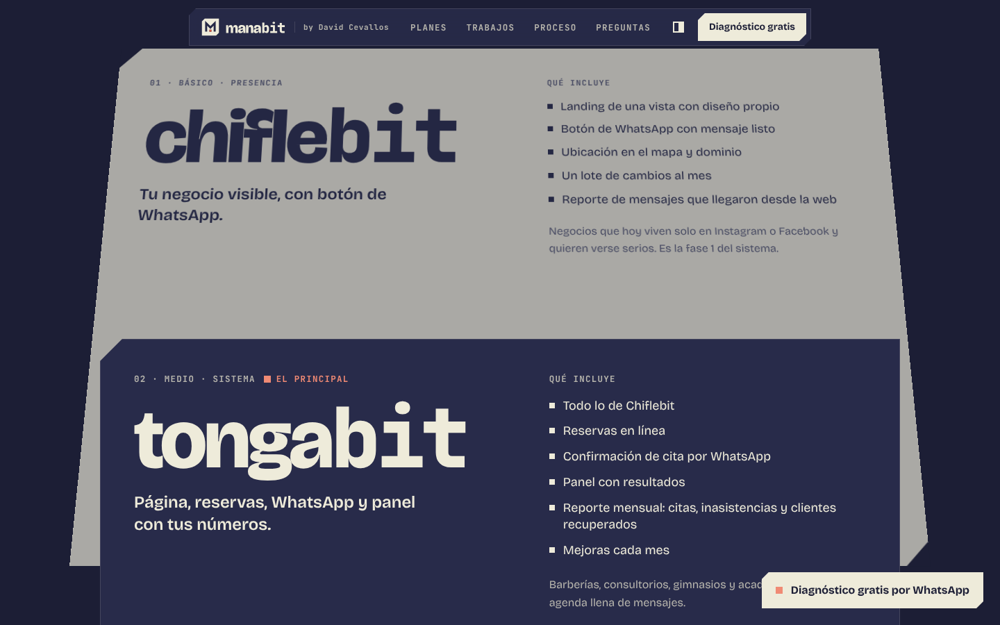
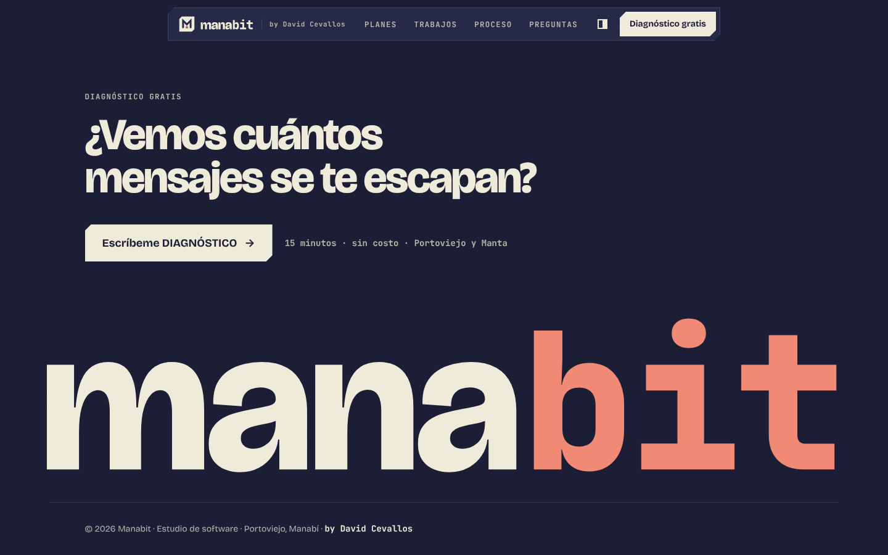
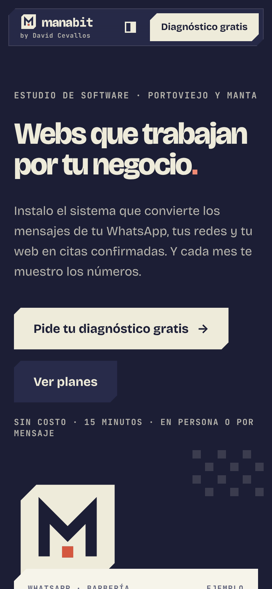

<div align="center">


# manabit

**Estudio de software · Portoviejo, Manabí**
Webs que trabajan por tu negocio.

[](https://nextjs.org)
[](https://react.dev)
[](https://www.typescriptlang.org)
[](https://tailwindcss.com)
[](https://motion.dev)

by **David Cevallos**

</div>

---

## Qué es

Manabit es un estudio de software de Portoviejo que instala y opera sistemas web para negocios de servicio: barberías, consultorios, gimnasios, academias y talleres. El sistema convierte los mensajes que llegan por WhatsApp, redes y web en citas confirmadas, y cada mes muestra los números.

Este repositorio es la landing del estudio. Su trabajo es uno solo: que el dueño de un negocio pida el **diagnóstico gratis** por WhatsApp.

## Vistazo

| Hero con demo en vivo | Planes en pila 3D |
|---|---|
|  |  |

| Cierre | Móvil |
|---|---|
|  |  |

## Secciones

| # | Sección | Qué hace | Técnica |
|---|---|---|---|
| 1 | Hero | El emblema se arma (barrido de la M y el bit cae) y un chat de ejemplo pasa de mensaje a **cita confirmada** en bucle | `motion` + `AnimatePresence`, se pausa fuera de pantalla |
| 2 | Rubros | Dos cintas infinitas con los tipos de negocio | `@keyframes` en CSS, pausa al pasar el puntero |
| 3 | Problema | Calculadora: mensajes por semana × % sin respuesta × % que agenda × valor de la cita = lo que se escapa al mes | Sliders nativos + contador con `useSpring` |
| 4 | Sistema | Qué se instala: página, reservas, WhatsApp, panel, reporte y mejoras | Bento con entrada escalonada |
| 5 | Planes | **Chiflebit**, **Tongabit** y **Toquillabit** | Sticky stack 3D ligado al scroll |
| 6 | Trabajos | 8 landings de muestra | Scroll horizontal pinneado |
| 7 | Proceso | Del diagnóstico gratis al reporte mensual | Línea que se rellena con el scroll |
| 8 | Preguntas | FAQ | Acordeón accesible con `grid-template-rows` |
| 9 | Cierre | CTA y `manabit` gigante; el *bit* entra al final en coral | Variantes de `motion` |

**Globales:** header flotante, CTA fijo tras el hero, cursor-píxel coral con spring, botones magnéticos, spotlight que sigue al puntero, smooth scroll con Lenis y tema noche/vainilla con transición radial (View Transitions).

## Los planes

Los nombres vienen de Manabí y terminan en *bit*, como la marca.

| Plan | Nivel | Qué incluye |
|---|---|---|
| **Chiflebit** | Básico · Presencia | Landing de una vista, botón de WhatsApp, ubicación, dominio y reporte de mensajes |
| **Tongabit** | Medio · Sistema | Todo lo anterior + reservas, confirmación por WhatsApp, panel y reporte mensual |
| **Toquillabit** | Premium · A la medida | Software de gestión diseñado sobre el flujo del negocio |

Los precios no se publican: cada botón abre WhatsApp con el mensaje **PLANES**.

## Stack

| Capa | Elección |
|---|---|
| Framework | Next.js 16 (App Router, `output: "export"`) |
| UI | React 19 + TypeScript estricto (`noUncheckedIndexedAccess`) |
| Estilos | Tailwind CSS v4 con tokens en `@theme` |
| Animación | `motion` (`motion/react`) + `@keyframes` para los bucles |
| Scroll | Lenis sobre scroll nativo (compatible con `useScroll`) |
| Fuentes | Bricolage Grotesque (eje `opsz`) y JetBrains Mono, servidas en local con Fontsource |

## Empezar

Requiere Node.js 20.9 o superior.

```bash
git clone https://github.com/DavidCevallos15/manabit.git
cd manabit
npm install
npm run dev          # http://localhost:3000
```

| Script | Qué hace |
|---|---|
| `npm run dev` | Servidor de desarrollo |
| `npm run typecheck` | `tsc --noEmit` |
| `npm run build` | Export estático en `out/` |

## Configuración

Todo lo del negocio vive en [`src/lib/site.ts`](src/lib/site.ts):

```ts
export const site = {
  whatsappNumber: "",   // 5939XXXXXXXX, sin "+"
  email: "",
  social: { instagram: "", tiktok: "", linkedin: "" },
  // …
};
```

- Sin número, los botones abren WhatsApp con el mensaje listo para elegir chat.
- Las redes y el correo vacíos no se muestran en el footer.
- Los textos de planes, trabajos, proceso y FAQ están en [`src/content`](src/content), separados de los componentes.

### Capturas reales de los trabajos

Las 8 muestras se dibujan en código con la paleta de cada rubro. Para usar una captura real, pon la imagen en `public/trabajos/<rubro>.webp` y agrega `image: "/trabajos/<rubro>.webp"` a esa muestra en [`src/content/samples.ts`](src/content/samples.ts).

## Estructura

```
src/
├── app/
│   ├── layout.tsx          # fuentes, metadatos, tema sin destello
│   ├── page.tsx            # composición de secciones
│   └── globals.css         # tokens noche/vainilla, easings, utilidades cut
├── components/
│   ├── brand/              # ManabitLogo + contornos del logo
│   ├── layout/             # SiteHeader, ThemeToggle, FloatingCta
│   ├── motion/             # Reveal, Marquee, StickyStack3D, Magnetic,
│   │                       # PixelCursor, Spotlight, SmoothScroll
│   └── ui/                 # Button, SectionHead, PixelGrid
├── content/                # planes, muestras, proceso, FAQ
├── lib/                    # site.ts, motion.ts, hooks.ts, cn.ts
└── sections/               # Hero, Rubros, Problem, Bento, Plans,
                            # Work, Process, Faq, Closing
```

## Marca

| Token | Hex | Uso |
|---|---|---|
| Noche | `#1C1E35` | Fondo por defecto |
| Medianoche | `#282B4A` | Superficies y tinta sobre vainilla |
| Vainilla | `#EEEBDA` | Texto sobre noche y fondo del tema claro |
| Coral | `#D4573F` | El bit sobre fondo claro |
| Coral claro | `#F08A74` | El bit y acentos sobre fondo oscuro |

- El coral aparece una vez por pieza: es el *bit* del logo.
- Las placas usan el mismo chaflán del emblema (`cut`, `cut-sm`, `cut-lg`).
- Easings por intención: `feedback`, `interactive`, `disclosure` y `reveal` en [`src/lib/motion.ts`](src/lib/motion.ts).

## Accesibilidad y rendimiento

- Con `prefers-reduced-motion`: sin Lenis, cursor, imán ni spotlight; la pila de planes queda plana y los trabajos se recorren con scroll manual.
- En pantallas táctiles no hay cursor ni imán; en móvil los planes se apilan en flujo normal.
- Contraste ≥ 4.5:1 en todos los pares de texto de ambos temas.
- Solo se animan `transform`, `opacity` y `clip-path`; los bucles corren en CSS.
- Fuentes locales (sin peticiones a Google Fonts) y cero imágenes externas.

## Despliegue

El build genera un sitio estático en `out/`.

- **Vercel:** importa el repo; detecta Next.js sin configuración.
- **Azure Static Web Apps:** `app_location: "/"`, `output_location: "out"`.

## Pendiente

- [ ] Número de WhatsApp, correo y redes en `src/lib/site.ts`
- [ ] Imagen Open Graph (1200 × 630)
- [ ] Dominio (`manabit.ec` / `manabit.dev`)
- [ ] Capturas reales de las landings de muestra

---

<div align="center">

**manabit** · Estudio de software · Portoviejo, Manabí
Diseñado y desarrollado by **[David Cevallos](https://github.com/DavidCevallos15)**

</div>
